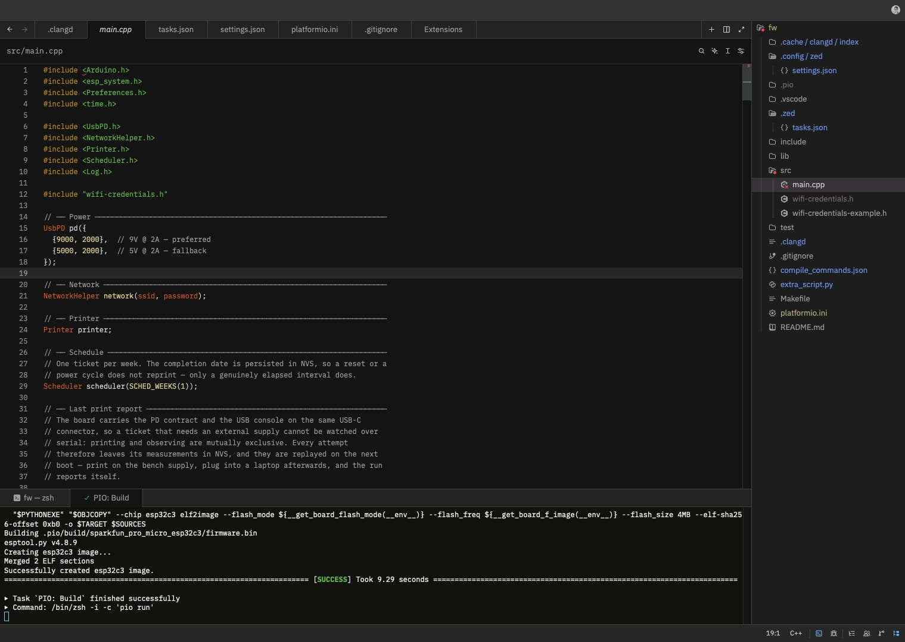

PlatformIO is best known as a VS Code extension, but all the work is done by its command line, `pio`. Zed has no official PlatformIO extension: it only needs two things to be comfortable on an ESP32 firmware such as the one in [PaperFlux](/post/paperflux/):

- **clangd**, the C/C++ language server Zed already uses, fed with a `compile_commands.json` file generated by PlatformIO;
- Zed **tasks** that call `pio` to build, flash and open the serial monitor.

It takes about ten minutes. We start from an existing PlatformIO project (a `platformio.ini` at the root).

## Installing the pio command line

On a Mac, the simplest way is Homebrew:

```bash
brew install platformio
pio --version
```

If you have already used the PlatformIO extension for VS Code, `pio` is already there, in `~/.platformio/penv/bin/`. No need to reinstall it: just add that folder to the `PATH`.

```bash
echo 'export PATH="$HOME/.platformio/penv/bin:$PATH"' >> ~/.zshrc
source ~/.zshrc
```

On Linux, `pipx install platformio` does the job. Either way, toolchains and frameworks are downloaded into `~/.platformio/packages/` on the first build: that is where clangd will find the framework and toolchain headers.

## What Zed offers

Zed handles C and C++ natively with clangd: completion, navigation, diagnostics, formatting. It uses the system clangd if it finds one, otherwise it downloads its own.

As for extensions, the only one named after PlatformIO is a community extension that adds syntax highlighting for `platformio.ini`. It is handy, but it neither builds nor uploads anything: that is what tasks are for.

## Generating compile_commands.json

Without a compilation database, clangd knows neither the Arduino or ESP-IDF includes nor the `-D` flags defined in `platformio.ini`, and the editor fills up with errors. PlatformIO can generate that database:

```bash
pio run -t compiledb
```

The `compile_commands.json` file is written at the project root, where clangd looks for it by default. Run the command again after each new library in `lib_deps`, each new source file, or when you switch environments (`pio run -e esp32-c3 -t compiledb`).

The file contains absolute paths specific to your machine: it has no place in git, and neither does clangd's index cache.

```gitignore
.pio/
compile_commands.json
.cache/
```

## Pointing clangd at the toolchain

The build uses the GCC shipped by PlatformIO (`xtensa-esp32-elf-g++`, `riscv32-esp-elf-g++`…), not Clang. clangd needs to know that toolchain's system headers (newlib, the C++ library…), otherwise it stumbles on the first include, for example on `'sys/reent.h' file not found`.

clangd's `--query-driver` option is often recommended for this, but it does not work here: PlatformIO writes the compiler without its path in `compile_commands.json` (`"command": "riscv32-esp-elf-gcc …"`), so clangd can neither find it nor match it against the pattern. The most reliable way is to have PlatformIO write the toolchain paths into the database itself, with a small script at the project root:

```python
# extra_script.py
# ruff: noqa: F821
# pyright: reportUndefinedVariable=false
Import("env")
env.Replace(COMPILATIONDB_INCLUDE_TOOLCHAIN=True)
```

```ini
; platformio.ini
[env:esp32-c3]
extra_scripts = pre:extra_script.py
```

`Import` and `env` are provided by SCons, PlatformIO's build engine, when it runs the script: the two comments at the top keep Zed's Python analyzer from flagging them as undefined.

Then regenerate the database with `pio run -t compiledb`. The `-I` flags pointing to the toolchain are now in it, and Clang infers the target architecture from the compiler's name (`riscv32-esp-elf-gcc`). Nothing needs to be set in Zed: the clangd it uses by default is enough.

## Silencing unknown GCC flags

clangd reads the same flags as GCC, and some of them are unknown to it: on ESP32, `-mlongcalls` or `-fstrict-volatile-bitfields` trigger an `unknown argument` error at the top of every file. A `.clangd` file at the project root removes them, for the editor only (the build does not change):

```yaml
CompileFlags:
  Remove:
    - -march=*
    - -mlongcalls
    - -fstrict-volatile-bitfields
    - -fno-tree-switch-conversion
    - -mtext-section-literals
```

On an ESP32-C3 (RISC-V), `-march=*` is essential: Espressif's GCC spells the architecture `rv32imc_zicsr_zifencei`, a syntax Clang rejects (`Unsupported argument 'rv32imc_zicsr_zifencei' to option '-march='`). The whole compile command is then dropped, and even `Arduino.h` can no longer be found. The trailing `*` removes every variant of the flag, and the architecture is still inferred from the compiler's name.

The list depends on the chip and the framework: add the flags clangd reports. To apply them to all your projects, the same content can go into `~/.config/clangd/config.yaml` (`~/Library/Preferences/clangd/config.yaml` on macOS).

After an `editor: restart language server`, completion on `WiFi.`, `Serial.` or the ESP-IDF APIs works, and `F12` leads all the way to the framework sources in `~/.platformio/packages/`.

## Building, flashing and monitoring with tasks

All that is left is to drive `pio` without leaving the editor. Zed reads the project's tasks from `.zed/tasks.json`:

```json
[
  {
    "label": "PIO: Build",
    "command": "pio run",
    "cwd": "$ZED_WORKTREE_ROOT"
  },
  {
    "label": "PIO: Upload",
    "command": "pio run -t upload",
    "cwd": "$ZED_WORKTREE_ROOT"
  },
  {
    "label": "PIO: Upload & Monitor",
    "command": "pio run -t upload -t monitor",
    "cwd": "$ZED_WORKTREE_ROOT",
    "use_new_terminal": true
  },
  {
    "label": "PIO: Monitor",
    "command": "pio device monitor",
    "cwd": "$ZED_WORKTREE_ROOT",
    "use_new_terminal": true
  },
  {
    "label": "PIO: Test",
    "command": "pio test",
    "cwd": "$ZED_WORKTREE_ROOT"
  },
  {
    "label": "PIO: Refresh compile_commands.json",
    "command": "pio run -t compiledb",
    "cwd": "$ZED_WORKTREE_ROOT",
    "hide": "on_success"
  }
]
```

`task: spawn` (`alt-shift-t` by default) opens the task list and `task: rerun` runs the last one again. The serial monitor runs in its own terminal (`use_new_terminal`), so its output stays visible while you rebuild. On a project with several environments, add `-e <name>` to the commands or duplicate the tasks per target.

For the most frequent tasks, a shortcut in `keymap.json` (`zed: open keymap`) even skips the list:

```json
[
  {
    "context": "Workspace",
    "bindings": {
      "cmd-alt-b": ["task::Spawn", { "task_name": "PIO: Build" }],
      "cmd-alt-u": ["task::Spawn", { "task_name": "PIO: Upload & Monitor" }]
    }
  }
]
```



## What is still missing

- **Debugging**: Zed can debug with GDB or CodeLLDB, but nothing connects it to the probes and configuration of `pio debug`. For stepping through code on the board, you have to go back to VS Code or run `pio debug --interface=gdb` in a terminal.
- **Automatic refresh**: unlike the VS Code extension, nothing regenerates `compile_commands.json` when `platformio.ini` changes. If clangd can no longer find an include, the first thing to try is the `PIO: Refresh compile_commands.json` task.
- **`.ino` files**: clangd does not understand them. A `src/main.cpp` with `#include <Arduino.h>` works better, and it is the default layout of a PlatformIO project anyway.

Apart from that, you get a fast editor, completion that knows the framework and three shortcuts to build, flash and read the serial output: everything I need day to day on a firmware.
